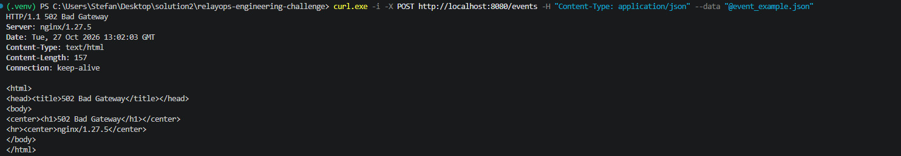
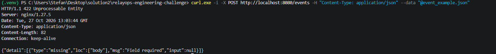
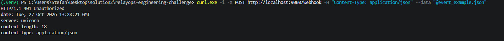
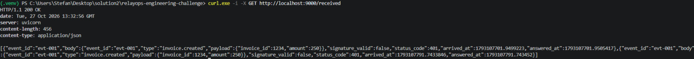

# SOLUTION

> Completează acest fișier. Răspunsurile scurte și concrete sunt preferate.

## 1. Probleme identificate și cum le-ai rezolvat

Pentru fiecare problemă: simptom → cum ai investigat (comenzi, loguri, ipoteze) → cauză → soluție.

| # | Componentă | Simptom | Cauză | Soluție |
|---|------------|---------|-------|---------|
| 1 |      `app/db.py`      |    worker-ul se initializa inainte de baza de date, crapa build-ul   |   lipsa `connection_timeout`    |    setam `_conn = psycopg.connect(DATABASE_URL, row_factory=dict_row, connect_timeout=3)`     |
| 2 |   `app/main.py` | inserarea aceluiasi eveniment de doua ori | lipsa modificatorului `UNIQUE` la nivel de baza de date din tabelul `events` | adaugarea operatorului `UNIQUE` la campul   `event_id` 
| 3 |   `app/main.py` | inserarea aceluiasi eveniment de doua ori | query-ul scris gresit | adaugarea ` ON CONFLICT (event_id) DO NOTHING`, daca e conflict si gaseste acelasi id , nu face inserarea, ci mai departe am adaugat un `SELECT` sa ne returneze evenimentul creat. Daca evenimentul deja exista , returnam codul de eroare `409` aferent.
| 4 |   `worker/worker.py` | inserarea aceluiasi eveniment de doua ori | fiecare worker se folosea de functia `fetch_pending`, returna evenimentul de doua ori | Modificare tabelului `events` si adaugarea coloanei `locked` (timpul de inchiriere) care ne spune daca un event a fost preluat de worker .
| 5 |   `worker/worker.py` | inserarea aceluiasi eveniment de doua ori | fiecare worker se folosea de functia `fetch_pending`, returna evenimentul de doua ori | rezolvarea a fost modificare de query, setand pe `statusul` pe `processing` cand un worker il preia, evitand interventia la al doilea worker, folosindu-ne  de o functia ` FOR UPDATE SKIP LOCKED`.
| 6 |   `worker/worker.py` | neintregistrarea reusitelor/nereusitelor ale evenimentelor | lipseste functia de inserarea in baza de date, si codurile aferente ale acestora | creearea functiei `record_attempt` si codurilor aferente `succes`, `temporary_error`, `permanent_error`, `retry_after`. Modificarea functiei `deliver` pentru adaugarea ramificarilor `if` pentru codurile aferente cu returnarea aferenta acestora
| 7 |   `worker/worker.py` | semnatura era compusa gresit | sign()` semnează json.dumps(body) (cu spații: ", ", ": ") -> httpx 0.28 serializează JSON-ul compact, fără spații. | adaugarea functiei `serialize()` care elimina spatiile si da raw bytes. Functia `deliver` modificata pentru a ne folosi de functia `serialize()` sa serializam body-ul , trimitand **aceeasi bytes**, rezolvand codul de eroare `401`
| 8 |   `app/main.py` | `delivery_attempts` nu se inregistreaza si nu este vizibila cand rulam API-urile pe endpoint-uri | lipsa inregistrarii acestora in functia ` get_event` | adaugarea unui query de select pe tabelul `delivery_attempts` aferent evenimentului pentru adaugarea informatiilor
## 2. Diagnostic networking

Descrie pașii prin care ai identificat problemele de rețea (ce ai rulat, ce ai observat).

#### 1. 502 BAD GATEWAY
- Am rulat un `POST` pe un eveniment nou si am vazut eroarea -> 502 BAD GATEWAY



- CAUZA -> Fisierul `receiver/Dockerfile` -> `CMD ["uvicorn", "receiver:app", "--host", "127.0.0.1", "--port", "9000"]` -> asculta doar pe localhost-ul la propriul container, am pus `0.0.0.0` , adresa default pentru ascultare oriunde.


#### 2. 422 error , body error
- Am rulat `curl.exe -s -X POST http://localhost:8080/events -H "Content-Type: application/json" --data "@event_example.json"`

- Request-ul vedea body-ul ca si empty. Problema era in fisierul `nginx.conf ->  proxy_pass_request_body off;`. Am comentat linia `  proxy_pass_request_body off;` si requestul-ul de `POST` a mers.

#### 3. Override la header per request + semnatura nevalida (rezolvarea din `worker.py)

- In fisierul `nginx.conf -> proxy_set_header Content-Length "";` -> override la setarile de pe partea worker-ului. Rezolvare -> il comentam si headere-le se ataseaza




#### 4. Payload-uri de până la 1 MB trebuie acceptate prin gateway.

- In fisierul  `nginx.conf -> client_max_body_size 1k;` ->  `nginx.conf ->  client_max_body_size 1m;`

## 3. Decizii tehnice

- Idempotency -> rezolvata in `create_event`
- Retry (ce erori consideri temporare, backoff):
- Recuperare după restart:
- Altele:

## 4. Cum pornești și verifici sistemul

```bash
docker compose down -v
docker compose up --build
# comenzi
```

- Scripturile din `\scripts` simuleaza requestu-rile aferente.

## 5. Instrumente AI utilizate

Ce instrumente ai folosit, pentru ce, și cum ai verificat ce au produs.
Menționează cel puțin un caz în care AI-ul a greșit și cum ai observat.
- Am folosit Cluade Opus 5.5 
- L-am folosit la partea de workeri -> Intelegeam de ce se insera evenimentul de doua ori , mi-am dat seama ca era de facut un fix in care se punea un `WORKER_TIME` care ii da un timp de inchiriere la fiecare worker sa termine evenimentul. Problema era ca fiecare worker lua evenimentul. I-am dat un timp de inchiriere la fiecare eveniment si depindea de ce worker era preluat. Daca evenimentul era inchiriat de worker-ul 1 , worker-ul 2 il lasa in pace. 

- Alta problema a fost la partea cu verificare semnaturii. Nu intelegeam de ce tot primeam raspuns 401 , desi semnatura se facea pe body-ul requestului, asa cum se cerea in documentatie. Am aflat dupa ca functia `sign()` semnează json.dumps(body) (cu spații: ", ", ": ") -> httpx 0.28 serializează JSON-ul compact, fără spații.


## 6. Ce ai îmbunătăți cu mai mult timp
- Terminarea la SIGTERM, sa ma documentez mai mult pe aceasta parte .